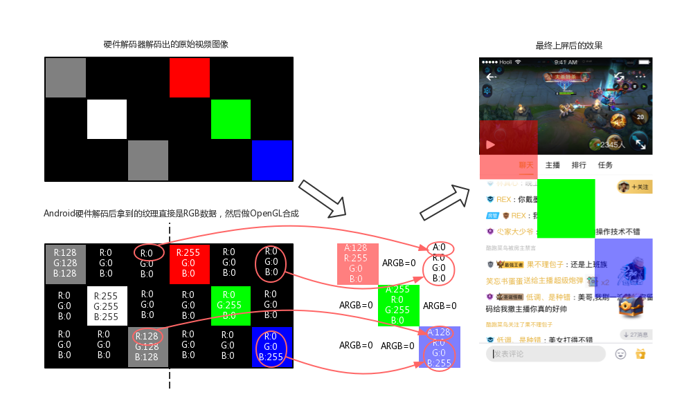
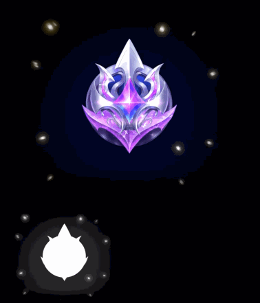
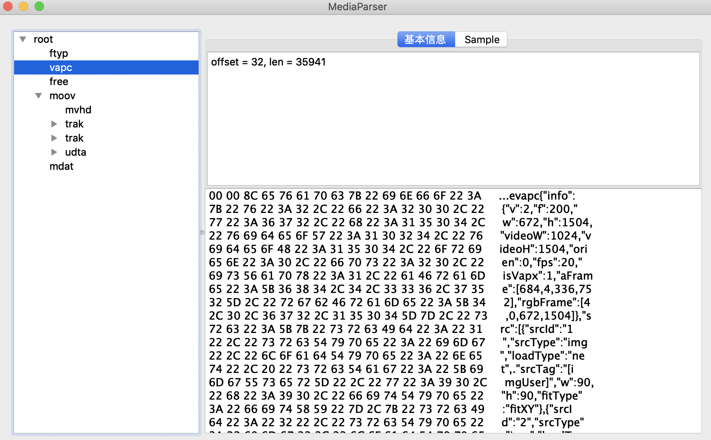
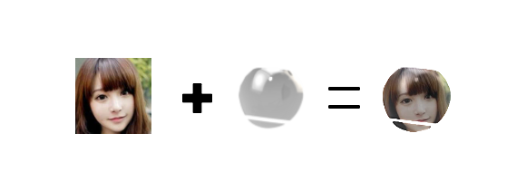
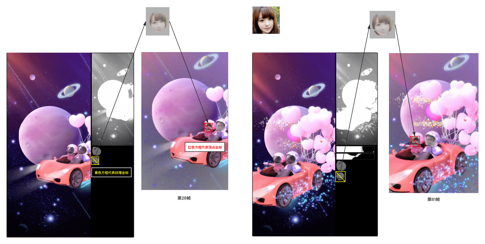
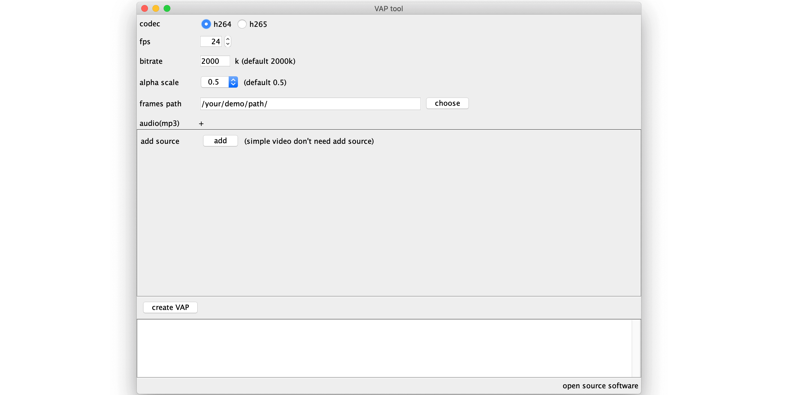

English | [简体中文](./Introduction.md)

The open-source VAP in this repository has been upgraded to the official Tencent Cloud **Gift AR Vap Pro SDK** (Android / iOS; you need to [apply for a License](https://tceffect-license.tmf.qq.com/) free of charge).
The open-source code and the MIT license remain valid, and existing integrations can keep using them; for commercial scenarios, we recommend upgrading to **[Tencent Cloud RT-Cube · Gift AR Enterprise SDK](https://trtc.io/document/70595?product=beautyar&menulabel=core%20sdk&platform=android)**.
For the migration guide, see [MIGRATION_en.md](./MIGRATION_en.md).

## 1. VAP

VAP (Video Animation Player) is an implementation developed by the Tencent Cloud team for playing eye-catching gift animations.

- Compared with WebP and APNG animated images, it offers a high compression ratio (smaller assets) and hardware decoding (faster decoding)
- Compared with Lottie, it supports more complex animation effects (for example, particle effects)

Effect showcase:

VAP can also blend custom attributes into an animation (for example, a user name or avatar).

## 2. Background

Penguin Esports is a live-streaming platform that needs to display eye-catching gift animations in live rooms.

The more impressive the animation, the higher the demands on asset size and decoding performance. We evaluated many solutions; here is the comparison first:

| Solution | File size | Decoding | Effect support |
| -------- | --------- | -------- | -------------- |
| Lottie | Cannot export | Software decoding | No particle effects |
| GIF | 4.6M | Software decoding | 8-bit color only |
| APNG | 10.6M | Software decoding | Fully supported |
| WebP | 9.2M | Software decoding | Fully supported |
| mp4 | 1.5M | Hardware decoding | No transparent background |
| VAP | **1.5M** | **Hardware decoding** | **Fully supported** |

* Test parameters:
	* Device: Xiaomi Mi MIX 3
	* Asset: 736 × 576, 80 frames
	* APNG: quality 75; WebP: quality 75; VAP: bitrate 2000

Solutions evaluated:

1. Vector animation (represented by Lottie): Lottie vector animations compress very well, but cannot render special effects such as particle effects, so this approach was not suitable;
2. Animated image approaches (GIF, APNG, WebP):
	* GIF: supports only 8-bit color, with severe color loss and low decoding performance, unable to deliver the required effects;
	* APNG and WebP: can deliver the effects, but the files are large and software decoding is inefficient (on low-end phones of the time, such as the Redmi 1, decoding could even stutter the entire live room), which was unacceptable;
3. Video approach (mp4): using H.264 encoding, it has a much higher compression ratio than animated images and very efficient hardware decoding, but has one clear drawback — it cannot support a transparent background;

The evaluation showed that every option fell short: Lottie and GIF could not deliver the effects, WebP and APNG were too large and still relied on software decoding, and mp4 had no transparency. To meet these requirements, the high-performance animation component VAP was created.

## 3. How It Works

### Choosing an Approach

The mp4 video approach is the best in terms of visual quality, file size and decoding performance, but H.264 stores YUV data with no alpha channel. VAP builds on mp4 and solves the transparency problem in video, thereby achieving both better compression efficiency and better decoding performance.

### Implementing Video Transparency

Each frame decoded from H.264 is YUV data, which has no alpha channel when converted to RGB. We can allocate an extra region in the video to store alpha values in the RGB channels, then use OpenGL to composite these into an ARGB image (an image with an alpha channel).

For example, after the decoder produces an original frame, the compositing principle is shown below:

Doing this for every frame yields a video with transparency. The actual videos are shown below:

Original video|Final result
---|---
|

In the original video, the black-and-white region carries the alpha data. The latest version of VAP supports a variable-sized alpha region; shrinking it reduces the video resolution without affecting the final display, improves device compatibility, and frees up the extra area for VAP's fusion feature.

### Animation Configuration

Playing an animation requires some configuration information (for example, the alpha region declaration and fusion animation information), stored in JSON format. To make the component easier to use, all related data is merged into the mp4 file, so playing an animation only requires a single mp4 file.

An mp4 file is organized much like JSON key-value pairs, in units called BOXes. We created a new BOX (`vapc`, VAP Config), placed the JSON content inside it, and read this BOX before playback (note: the mp4 specification says unrecognized BOXes are ignored automatically, so normal mp4 playback is unaffected).

### VAP Fusion Animation

VAP also supports blending custom attributes into an animation, such as a user name or avatar. We call this VAP fusion animation.

Video content cannot have attributes inserted directly, so we take an indirect approach: by clipping the attribute image, we "trick the eye" into seeing it as part of the video content, achieving the final fusion effect (as shown at the beginning of this article).

To process the attribute image, a "mask" asset is introduced. Applying Porter-Duff operations to the mask and the attribute image produces the required shape.

The result is then drawn at the corresponding coordinates in the video to produce the final fusion effect.

The "mask" asset is stored in each video frame, making use of the area freed up by shrinking the alpha region. The principle is illustrated below.

Actual video:

## Companion Tools

To make the component easier to use, a companion asset authoring tool is also provided.

## License

VAP is under the MIT license. See the LICENSE file for details.
